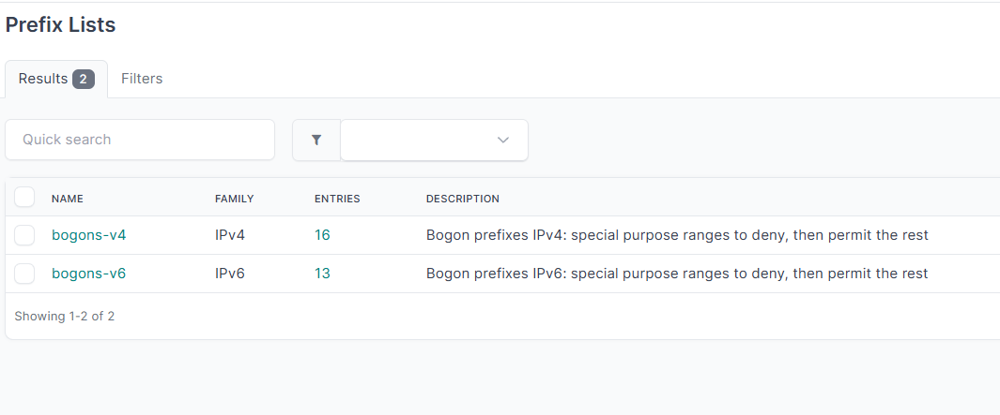
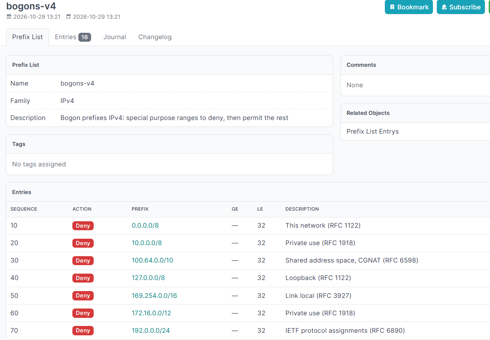
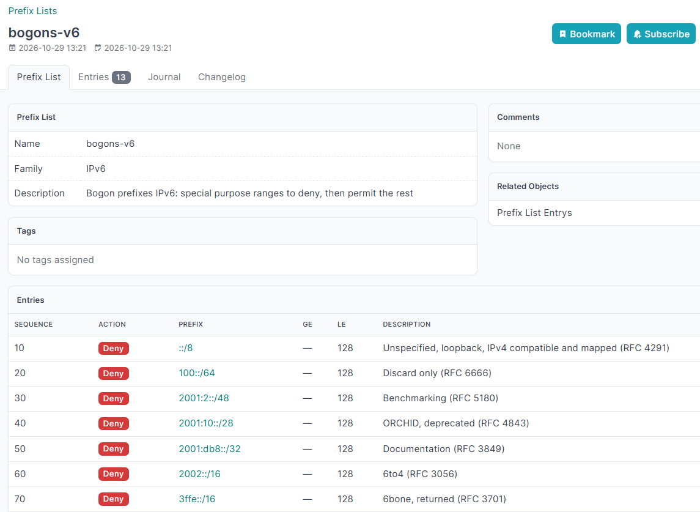
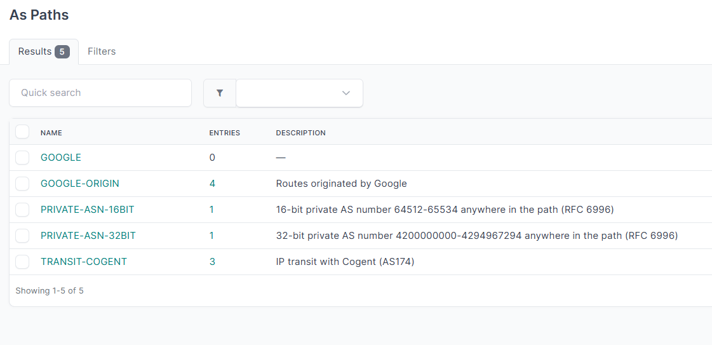
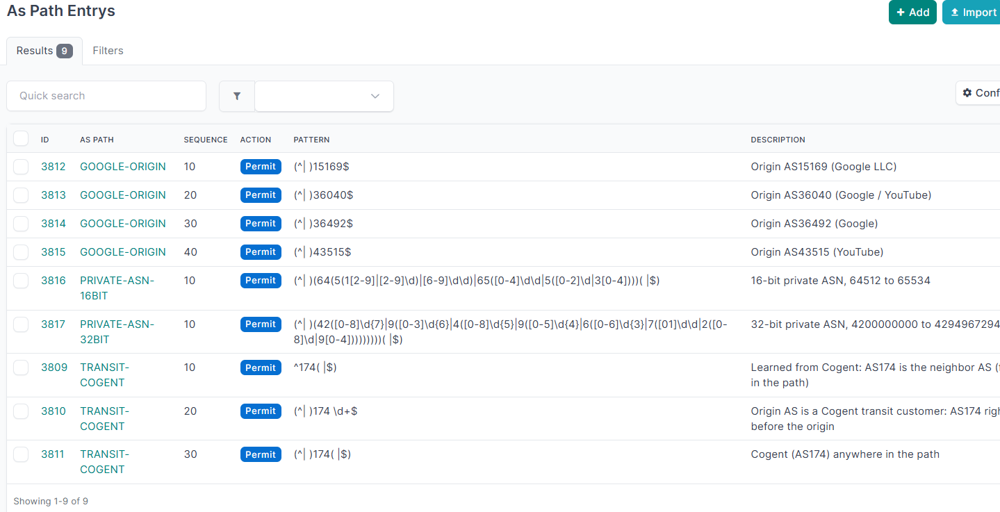
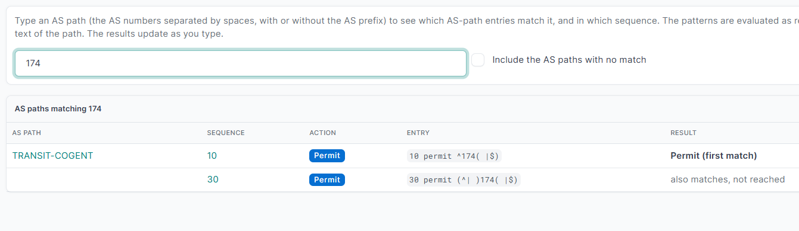
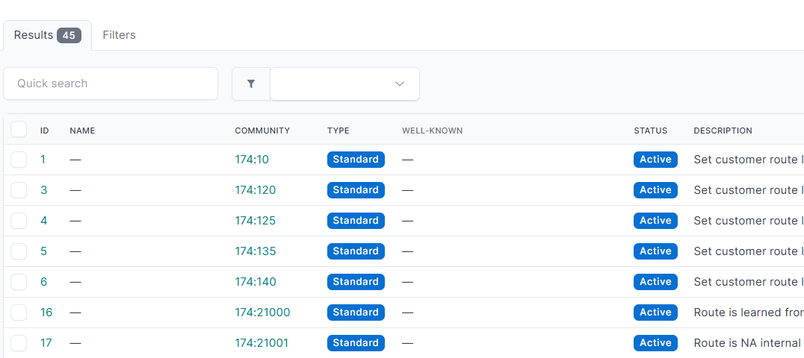
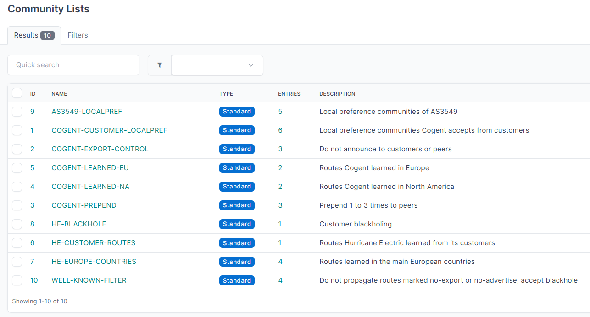
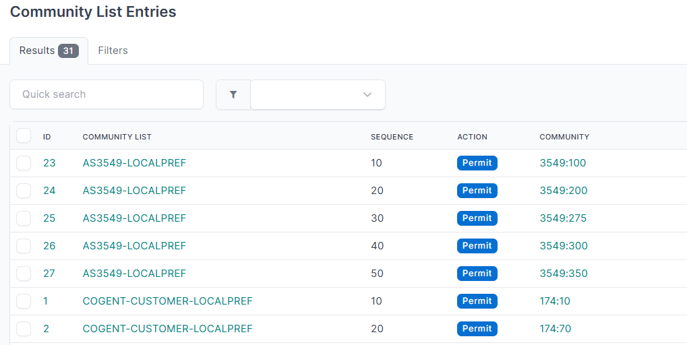
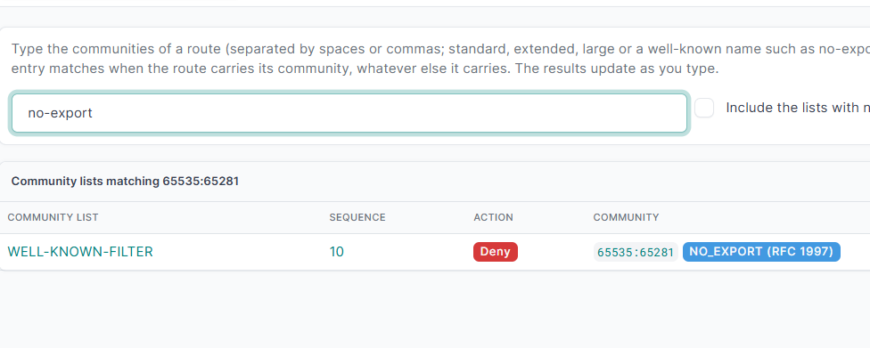

# Routing objects

**Routing → Routing Objects**

Routing objects are the building blocks that policies are made of. They are not tied to one protocol:
today BGP policy templates and peer address families point at prefix lists and route policies.

> **About the standards.** Prefix lists, route policies and AS-path filters are **vendor features**: no RFC defines them, and
> every vendor spells them a little differently. What the RFCs define is what they act on: IP
> prefixes ([RFC 4632](https://www.rfc-editor.org/rfc/rfc4632) for IPv4 CIDR,
> [RFC 4291](https://www.rfc-editor.org/rfc/rfc4291) for IPv6), the BGP `AS_PATH` attribute
> ([RFC 4271](https://www.rfc-editor.org/rfc/rfc4271) §5.1.2) and BGP communities
> ([RFC 1997](https://www.rfc-editor.org/rfc/rfc1997)). Those are the pieces the plugin validates.

## Prefix lists

**Prefix Lists** and **Prefix List Entries**

A prefix list is an ordered list of rules; each rule says *permit* or *deny* the prefixes it matches.
Routers evaluate the entries in sequence order and stop at the first that matches.

For example, a bogon filter has one list per family. Each one denies the special purpose ranges (every entry with *LE* at the longest length, so it also covers the more specific prefixes) and ends with a *permit* of *Any* so that it can be used as an inbound filter:

### Prefix list

| Field | Meaning |
| --- | --- |
| Name | Name of the list, as used in the device configuration. |
| Family | **IPv4** or **IPv6**. A list holds only one family, and the family **cannot be changed** once the list exists (its entries would stop making sense). |



### Prefix list entry

| Field | Meaning |
| --- | --- |
| Prefix list | The list the entry belongs to. |
| Sequence | Evaluation order, 1 to 4294967294 (the range routers accept). Leave it empty and the form suggests the next free one; the API assigns it automatically. |
| Action | Permit (the default in the form) or Deny. The action belongs to the entry, as on routers; the route policies and BGP policies that use the list only decide *where* it is applied. |
| Prefix | A prefix from NetBox IPAM (**IPAM → Prefixes**). It must be of the family of the list. |
| Any | Matches the all-zeros prefix of the family (`0.0.0.0/0` or `::/0`). NetBox IPAM cannot hold that prefix, so this checkbox stands for it. With *LE* set to the longest length (32 or 128) it matches *every* prefix. Leave *Prefix* empty when you use it. |
| GE / LE | The length range of the match, as on routers. *GE* ("greater than or equal") and *LE* ("less than or equal") are lengths, not counts. Both are inclusive. |
| Exact | Form only: tick it to match the prefix itself, with no length range. GE and LE are disabled while it is ticked and the form refuses them if both come in. It is the same as leaving GE and LE empty. |

#### IPv4 Bogons example



#### IPv6 Bogons example



How to read GE and LE for a prefix `10.0.0.0/8`:

| GE | LE | Matches |
| --- | --- | --- |
| – | – | exactly `10.0.0.0/8` |
| 16 | – | any prefix inside `10.0.0.0/8` of length 16 or longer, up to /32 |
| – | 24 | `10.0.0.0/8` and everything inside it up to /24 |
| 16 | 24 | prefixes inside `10.0.0.0/8` with a length from 16 to 24 |

The plugin refuses a GE or LE that is shorter than the prefix, longer than the family allows (32 for
IPv4, 128 for IPv6) or when GE is greater than LE.

> **A prefix used by a list is protected.** A NetBox prefix referenced by a prefix list entry **cannot be deleted**, and a change to it that
> would make an entry invalid (for example shortening the prefix below the entry's GE) is refused,
> with a message that names the entries. Remove or edit the entries first.

### Using the API

The REST API (`/api/plugins/routing/objects/prefix-list-entry/`) follows the same rules as the form:

- **`sequence`** can be left out; the entry gets the next multiple of 10 after the highest one in the list. Any value from 1 to 4294967294 is accepted when you send it.
- **Any:** send `"any_prefix": true` and no prefix, or send the prefix as `"any"`, `"0.0.0.0/0"` or `"::/0"`; all three store the same entry.
- **`eq`** (write only, not in the form) sets GE and LE to the same length.
- **`exact`** (write only) is the *Exact* checkbox of the form: `true` matches the prefix itself, so `ge`, `le` and `eq` must be empty (an error otherwise); with `any` it is only the all-zeros prefix.
- The response of a create or update carries a **`warnings`** list with the overlaps described below, so scripts can show them. The entry is saved anyway.

### Importing lists and entries

**Prefix Lists** and **Prefix List Entries** have an *Import* button in the menu (CSV, JSON or YAML, like any NetBox object). Import the lists first, then their entries.

Prefix lists:

```
name,family,description
EDGE-IN,4,Routes accepted from the edge
EDGE-IN-V6,6,
```

`family` is 4 or 6 (4 when empty).

Entries:

```
prefix_list,action,prefix,sequence,ge,le,eq,vrf
EDGE-IN,permit,10.0.0.0/8,,16,24,,
EDGE-IN,deny,192.0.2.0/24,,,,,
EDGE-IN,permit,any,,,,,
```

| Column | Meaning |
| --- | --- |
| `prefix_list` | Name of an existing list. |
| `action` | `permit` or `deny`. |
| `prefix` | A prefix that **already exists in IPAM**, written as a CIDR, or `any`. Nothing is created in IPAM: a prefix that does not exist is an error. |
| `vrf` | Name of the VRF of the IPAM prefix. Only needed when the same CIDR exists in several VRFs; without it that is an error. |
| `sequence` | Empty takes the next free one of the list (steps of 10, consecutive inside one import). |
| `ge`, `le`, `eq` | As in the form. `eq` sets GE and LE to one length, and cannot be combined with them. Leave all three empty to match the prefix itself (with `any`, every prefix). |

The whole import is rolled back if one row is wrong, and the rows are checked with the same rules as the form (family, lengths, sequence). The entries are saved even if they overlap (see below); after the import you get **a summary per list** with how many overlaps of each kind involve the imported entries (each pair counted once, including the entries the list already had) and the first examples.

### Resequencing a list

When the gaps between the sequence numbers are used up, the **Resequence** button on the page of the list renumbers its entries **keeping their order**: it asks for the first number (10 by default) and the step (10 by default), and the entries get the first number and then each next one the step above. The order does not change, so neither does what the list does; the overlap results are the same. Entries that already have their number are left alone, and it refuses to run, changing nothing, if the last number would go over 4294967294. You need the permission to change prefix list entries.

Over the API: `PATCH /api/plugins/routing/objects/prefix-list/<id>/resequence/` with optional `start` and `step`; it answers `{"changed": <number of entries renumbered>}`.

### Duplicating a prefix list

The **Duplicate** button on the page of a list makes a copy **with all its entries**: a form asks for the name of the copy (it suggests *name copy*) and its description, and the copy keeps the family, comments, tags and owner. Every entry is copied as it is (sequence, action, prefix or Any, GE/LE, description, tags) and keeps pointing to the same IPAM prefixes. The copy has the same address family: the entries of an IPv4 list cannot be copied into an IPv6 one. You need the permission to add prefix lists and prefix list entries.

### Deleting a prefix list in use

A prefix list that other objects use can be deleted. Before you confirm, the dialog (and the bulk delete page) lists **every object that refers to it, whatever the protocol**: BGP policy templates and peer address families, route policy entries, and anything that points to a prefix list in the future, grouped by type with links. Deleting the list leaves the reference empty in those objects (and removes the list from the route policy entries), so their filtering stops applying until you choose another list. The list's own entries are deleted with it.

### Overlap warnings

When you save an entry the plugin compares it with the other entries of the list and warns (it still
saves) about:

| Warning | Meaning |
| --- | --- |
| **Duplicate** | Another entry matches exactly the same prefixes. |
| **Shadowed** | An earlier entry matches everything this one matches, so this entry is never reached. |
| **Shadows** | This entry matches everything a later entry matches, so that later entry is never reached. |
| **Nested** | One covers the other, with the more specific first. This is the normal way to write an exception, so it is shown for information. |
| **Overlaps** | They share some prefixes but neither covers the other. |

The entry's detail page lists the overlapping entries, and a prefix list's page shows where the list
is used.

### Adding entries from the list

The page of a prefix list shows its entries in a table at the bottom, with an **Add entry** button that opens the entry form with the list already chosen and the next sequence number suggested. After saving, you come back to the list's page.

### Search Prefix Match

**Routing → Routing Objects → Search Prefix Match**

Type a prefix or a plain address (`10.0.0.0/24`, `192.0.2.1`, `2001:db8::/32`) and the page shows,
as you type, which prefix list entries match it, **in which sequence**, and whether the entry permits
or denies it. An address is treated as a host prefix. Tick *Include the lists with no match* to see
the lists that do not match too. It answers "would this prefix get through that filter?" without
logging in to a router. It needs the *view* permission on prefix list entries.

## Route policies

**Route Policies** and **Route Policy Entries**

A route policy is an ordered list of rules like a prefix list, but each rule can *match* several
attributes and *set* others.

| Field | Meaning |
| --- | --- |
| Route policy | Name of the map. |
| Sequence | Evaluation order, 1 to 4294967294 (the range routers accept; 0 is not valid). Leave it empty and the entry takes the next multiple of 10 above the last one: the add form suggests it when you come from the policy, the API assigns it (consecutive numbers in a bulk request) and the import fills it. Any value is still accepted. |
| Action | Permit (the default in the form) or Deny. The action belongs to the entry, as on routers; the route policies and BGP policies that use the list only decide *where* it is applied. |
| Jump to route policy | Optional, on a permit entry: when the entry matches, the evaluation **goes on in that route policy and does not come back** (a *goto*, like Juniper `next policy`). A jump that would make a loop (the other policy leads back to this one) is refused, and a route policy that is the target of a jump cannot be deleted. |

### What an entry matches

An entry can have any of these conditions; **all of them must hold** (AND), and inside a list
(several prefix lists, say) **any one is enough** (OR), as on the routers. An entry without
conditions matches every route. They follow the BGP path attributes of RFC 4271 section 5.1
(the names are the ones the vendors use, Cisco `match ...` among them).

| Field | Meaning |
| --- | --- |
| Match prefix list | Prefix lists the route's prefix must match. |
| Match AS path | AS-path lists (patterns) the AS_PATH must match (RFC 4271 section 5.1.2). |
| Match community list | Community lists the communities and extended communities of the route must match (RFC 1997, RFC 4360). |
| Match next hop | NEXT_HOP of the route (RFC 4271 section 5.1.3): an **IPv4 or IPv6 address of IPAM**. |
| Match metric | MULTI_EXIT_DISC (RFC 4271 section 5.1.4), 0 to 4294967295. |
| Match origin | ORIGIN (RFC 4271 section 5.1.1): IGP, EGP or Incomplete. |
| Match tag | Route tag, 0 to 4294967295. **Not a BGP attribute**: only some vendors have it (for example Cisco and FRR). |
| Match weight | 0 to 65535. **Not a BGP attribute**: only some vendors have it (for example Cisco and FRR), and it never leaves the router. |

### What an entry sets

What the entry changes in the routes it permits. **A deny entry only denies**: it cannot set
anything and cannot jump, and the form and the API refuse it.

| Field | Meaning |
| --- | --- |
| Set local preference | LOCAL_PREF (RFC 4271 section 5.1.5), 0 to 4294967295. |
| Set next hop | NEXT_HOP (RFC 4271 section 5.1.3): an **IPv4 or IPv6 address of IPAM**. |
| Set AS-path prepend | AS numbers added at the start of the AS_PATH, in the order written (a number repeated is prepended several times), each 0 to 4294967295. Written as numbers separated by commas. |
| Set community list and mode | The communities and extended communities that the **permit** entries of the list hold, and what to do with them: **Replace** the communities of the route, or **Additive** (add them to the ones it has). No mode, no list, nothing is done. |
| Set metric and mode | MULTI_EXIT_DISC, 0 to 4294967295, and how: **Set** (the default), **Add** the value or **Subtract** it. |
| Set origin | ORIGIN: IGP, EGP or Incomplete. |
| Set tag | Route tag, 0 to 4294967295. **Not a BGP attribute**: only some vendors have it. |
| Set weight | 0 to 65535. **Not a BGP attribute**: only some vendors have it. |

An IP address that an entry uses as a next hop **cannot be deleted** from IPAM until the entry
stops using it. A community list used by a *set* can be deleted: the entry then keeps the mode
and sets nothing, until you choose another list.

Not modelled, because they are not BGP path attributes: source protocol, interface, route type,
metric type, and the vendor specific ones that follow them. Extended communities go through the
community lists, as the same list can hold both kinds.

### How an entry is evaluated

The entries are evaluated in the order of their sequence and **the first one that matches decides** the route:

- The conditions of one entry combine with **AND**: the route has to meet all of them. Several objects of the same kind (two prefix lists, two AS paths) combine with **OR**: any one is enough. An entry without conditions matches every route.
- A **community list** condition is **match all**: the route has to carry **all** the communities of the permit entries of the list. (Decided for now; it can change if users ask for *any* or *exact*.)
- A **deny** entry that matches denies the route and the evaluation stops. A **permit** entry that matches permits it, applies its *set* values, and if it has a **jump** the evaluation goes on in the other route policy (and does not come back); otherwise it stops.
- A route that no entry matches is **denied**: see the final deny below.

### The final deny

Every route policy ends in a **deny of everything**, as on the routers. It is not drawn by the page: it is an entry of the model (sequence 4294967295, just above the range of yours, `implicit` true), created together with the policy and for the policies that existed before it was added, so it is there when you query the API or GraphQL, and it is always the last one. It cannot be edited, deleted, moved or chosen in a bulk action, it is not counted in the number of entries of a policy and the resequence and the duplicate leave it alone (the copy has its own). Filter with `implicit=true` to find them.

### Entries that are never evaluated

An entry without conditions decides every route that reaches it, so the entries after it are never evaluated. It is **allowed**, but the page of the route policy shows an alert, above the entries, with the entry that stops the others and the ones that are left unreachable.

### Searching what a route policy does with a route

**Route Policies → Search Route Policy Match** takes a route and shows, for one policy or all of them, how it is evaluated, entry by entry, the way [explained above](#how-an-entry-is-evaluated): every condition of each entry with ✓ or ✗, the entry that decides, whether the result is **permit** or **deny**, what a permit entry **sets**, and the jumps to other policies followed to the end. The route is described with any of: prefix, AS path, communities, next hop, metric, origin, tag and weight. Everything is optional, but an entry that has a condition on a field you did not give is not met. The prefix lists, AS paths and community lists are evaluated with the rules of their own search tools: a prefix list or an AS path is met when its first matching entry permits, and a community list when the route carries all the communities of its permit entries. A route that no entry matches ends in the final deny. You need the permission to view route policy entries.

### Where a route policy is used

The page of a route policy lists, with a link to the filtered list of each, where it is used: the BGP policy templates and peer address families (in and out), the OSPF instances, IS-IS instances and EIGRP routers that take it as their import or export policy, and the entries of other route policies that jump to it. A policy that appears there cannot be deleted.

When you delete a prefix list, an AS path or a community list that route policy entries match, the confirmation lists those entries and warns that **an entry with no other condition will then match every route**. An entry without conditions is shown as *Matches every route* on its page (and in an optional column of the tables), and saving one shows a warning, besides the alert of the policy page about the entries it leaves unreachable.

### Working with entries

The page of a route policy has an **Entries** panel with an **Add entry** button (the form opens with the policy chosen, **permit** preselected and the next sequence suggested), and the tables of entries have the edit, delete and changelog buttons. **Duplicate** on the page of a policy copies it **with all its entries** under a new name (suggested: `<name> copy`): every entry keeps its sequence, action, match and set values, lists, next hops, tags and description. You need the permission to add route policies and route policy entries.

The tables of entries show two columns by default: **Match** (one line per condition, *any* when the entry has none) and **Set** (one line per action it applies), next to the sequence, the action and the jump. Every match and set field also has its own column, hidden by default, that you can turn on from *Configure Table* to sort or export by it. Weight is shown as well, although it is not a standard BGP attribute.

The tables can be filtered (also over the API and GraphQL) by name and description, by action, sequence and policy, by the prefix lists, AS paths and community lists an entry matches, and by every match and set value; the list of policies also by what its entries match. The tables can show the entries count of each policy and the lists an entry matches. The bulk edit changes the action, the jump and the match and set values of the selected entries.

### Importing route policies and entries

**Route Policies** and **Route Policy Entries** have an *Import* button in the menu (CSV, JSON or YAML, like any NetBox object). Import the policies first, then their entries. The entries are written with the name of the policy in `route_policy` and `action`; the optional columns:

- `sequence`: empty takes the next free one of the policy.
- `match_prefix_list`, `match_aspath`, `match_community_list`: names, several separated by commas.
- `match_next_hop`, `set_next_hop`: an IPAM address without the mask; `vrf` says which one when the address is in several VRFs.
- `match_metric`, `match_origin`, `match_tag`, `match_weight`, `set_local_preference`, `set_metric`, `set_metric_mode`, `set_origin`, `set_tag`, `set_weight`: the values of the tables above.
- `set_aspath_prepend`: AS numbers separated by spaces. `set_community_list` and `set_community_mode`: the name of the list and `replace` or `additive`.

A `deny` entry with a `set_` column is refused.

### Resequencing a route policy

The **Resequence** button on the page of the route policy renumbers its entries **keeping their order**, as it does for prefix lists: first number and step (10 by default), nothing changes if the last number would go over 4294967294, and you need the permission to change route policy entries. The final deny (see below) stays at the end. Over the API: `PATCH /api/plugins/routing/objects/route-policy/<id>/resequence/` with optional `start` and `step`; it answers `{"changed": <number of entries renumbered>}`.

### Deleting a route policy in use

A route policy that a protocol uses **cannot be deleted**: BGP policy templates and peer address families, the import and export policy of an OSPF instance, an IS-IS instance or an EIGRP router, and the entries of another route policy that jump to it. The delete is refused, in the web interface (single and bulk) and in the API, and the message names the objects that use it. Choose another policy in them, or clear the field, and then delete it. The entries of a policy that is not in use are deleted with it.

## AS paths

**AS Path** and **AS Path Entries**

An AS-path list filters routes by the sequence of autonomous systems they crossed (the BGP `AS_PATH`
attribute, [RFC 4271](https://www.rfc-editor.org/rfc/rfc4271) §5.1.2). Route policy entries use it
to match routes (see [Route policies](#route-policies)).

### AS path and entry



| Field | Meaning |
| --- | --- |
| Name | Unique, ignoring case. |
| Sequence (entry) | `1` to `4294967294`, the same range as a prefix list. Entries are evaluated in this order. Empty takes the next free one, see below. |
| Action (entry) | **Permit** or **Deny**. New entries start with *permit*. |
| Pattern (entry) | The match, see below. |

The **pattern** is a regular expression written over the AS numbers of the path, which are read as
text separated by single spaces (`65001 65002 65003`). It is evaluated with the Python
[`regex`](https://pypi.org/project/regex/) module (a superset of the standard `re`), which is also
what *Search AS Path Match* runs: the plugin stores and shows the pattern as you wrote it, does not
translate it, and is not tied to any vendor's own dialect. What it checks is that the AS-path you
enter is valid. A pattern is accepted when:

- it is not empty and has only printable ASCII characters;
- it compiles as a regular expression;
- every AS number written in it fits the 32-bit AS_PATH ([RFC 6793](https://www.rfc-editor.org/rfc/rfc6793)),
  that is `0` to `4294967295`. Digits in escapes, brackets and repetitions (`\1`, `[0-9]`, `{2,3}`)
  are not AS numbers. The dot is the wildcard of regular expressions, so an asdot number
  ([RFC 5396](https://www.rfc-editor.org/rfc/rfc5396)) is written with an escaped dot (`1\.10`).

The usual constructs work: anchors `^` and `$`, groups and alternatives `(65002|65003)`, classes
`[0-9]`, `\d` and the POSIX ones such as `[[:digit:]]`, repetitions `*`, `+`, `?`, `{m,n}`, and the
dot. Examples that are valid: `^65001 `, `(65002|65003)$`, `^[0-9]+$`, `^65001( 65002)*$`,
`^65001 \d+$` and `.*`. The underscore `_` has no special meaning (it is a plain character), and
neither has the `AS` prefix: patterns are written over the bare numbers.



A pattern is not proved safe: some regular expressions can take very long on some paths (nested
repetitions such as `(\d+ ?)+`). *Search AS Path Match* gives each entry a fraction of a second, and
the entries that take longer are skipped and listed in a warning, instead of hanging the page. The
whole search also has a limit of a few seconds: if it is reached, the entries not yet evaluated are
counted in a warning and the results may be incomplete.

Leave the **sequence** empty and the entry takes the next multiple of 10 above the last one of the
AS-path (the form suggests it when you add an entry from the AS-path, and the API and the import
assign it; entries of one bulk request get consecutive numbers). Any value is still accepted. The
sequence of an entry that already exists cannot be emptied, so it never moves by accident.

Entries are evaluated by sequence and the first match wins, so an entry with the **same pattern** as
another one of the same AS-path could never be reached. That is why **a pattern cannot be repeated in
an AS-path**: saving it from the form, the API, the import or the bulk edit is refused with *This
AS-Path already has an entry with this pattern*. The same pattern in two different AS-paths is fine.
Only identical patterns are detected: whether two different regular expressions overlap cannot be
decided in general.

### The page of an AS path

It shows the entries with an **Add entry** button (the form opens with the AS-path chosen, the next
sequence suggested and *permit* preselected), and where the AS-path is used, like a prefix list: the
route policy entries that match it, their route policies, and the BGP policy templates and peer
address families that apply those policies (in or out), each with a link to the filtered list.
**Duplicate** copies an AS-path with all its entries under a new name (suggested: `<name> copy`).

The lists and the entry tables have the edit, delete and changelog buttons, and can be filtered by
name, description, AS-path, action, sequence and pattern. The description and tags can be shown as
columns. Bulk edit changes the description, the AS-path or the action of several entries at once.

### Resequencing an AS path

When the gaps between the sequence numbers are used up, the **Resequence** button on the page of the
AS-path renumbers its entries **keeping their order**: it asks for the first number (10 by default)
and the step (10 by default), and the entries get the first number and then each next one the step
above. The order does not change, so neither does what the AS-path does. Entries that already have
their number are left alone, and it refuses to run, changing nothing, if the last number would go
over 4294967294. You need the permission to change AS-path entries.

Over the API: `PATCH /api/plugins/routing/objects/as-path/<id>/resequence/` with optional `start` and
`step`; it answers `{"changed": <number of entries renumbered>}`.

### Examples

Four AS paths that show what the patterns are for. The numbers of a path are separated by spaces, so
`(^| )` means "the start or a space" and `( |$)` "a space or the end", which keeps `174` from
matching inside `1174` or `1740`.

**`TRANSIT-COGENT`**, IP transit with Cogent (AS174):

| Sequence | Matches |
| --- | --- |
| 10 | Learned from Cogent: AS174 is the neighbor AS, the first in the path. |
| 20 | The origin AS is a transit customer of Cogent: AS174 right before the origin. |
| 30 | Cogent anywhere in the path. |

```
10  ^174( |$)
20  (^| )174 \d+$
30  (^| )174( |$)
```

**`GOOGLE-ORIGIN`**, routes originated (last AS of the path) by one of the Google ASNs, one entry
each (AS15169, AS36040, AS36492 and AS43515):

```
10  (^| )15169$
20  (^| )36040$
30  (^| )36492$
40  (^| )43515$
```

**`PRIVATE-ASN-16BIT`**, a 16-bit private AS number, 64512 to 65534
([RFC 6996](https://www.rfc-editor.org/rfc/rfc6996)), anywhere in the path:

```
10  (^| )(64(5(1[2-9]|[2-9]\d)|[6-9]\d\d)|65([0-4]\d\d|5([0-2]\d|3[0-4])))( |$)
```

**`PRIVATE-ASN-32BIT`**, a 32-bit private AS number, 4200000000 to 4294967294, anywhere in the path:

```
10  (^| )(42([0-8]\d{7}|9([0-3]\d{6}|4([0-8]\d{5}|9([0-5]\d{4}|6([0-6]\d{3}|7([01]\d\d|2([0-8]\d|9[0-4]))))))))( |$)
```

A number range needs a pattern like the two private ones, because a regular expression compares
digits, not values. Try them in *Search AS Path Match*, next: `174 3356 64500` matches
`TRANSIT-COGENT` entries 10 and 30, `3356 15169` matches `GOOGLE-ORIGIN`, `65000 65001` the 16-bit
private AS path and `4200000001 174` the 32-bit one (and Cogent, entry 30).

### Search AS Path Match

**Routing → Routing Objects → Search AS Path Match**

Type an AS path, the AS numbers separated by spaces (`65001 65002 4200000000`; asdot such as `1.10`
also works, and the usual `AS` prefix is accepted: `AS65001 AS65002` is read as `65001 65002`; nothing
is stored, the patterns stay over the bare numbers), and the page shows, as you type, which AS-path entries match it, **in which sequence**,
and whether the entry permits or denies it; the first match of each AS-path is the effective one,
the others are marked as not reached. Tick *Include the AS paths with no match* to list those too.
The patterns are evaluated as regular expressions over the text of the path (the
numbers separated by one space), so `^65001 ` matches a path that starts with 65001. The path is the
flat list of numbers: an empty path, AS_SET and confederation segments
([RFC 4271](https://www.rfc-editor.org/rfc/rfc4271) §4.3, [RFC 5065](https://www.rfc-editor.org/rfc/rfc5065))
are not modelled. No implicit
deny is assumed when nothing matches, because that is how a platform behaves, not how the plugin
stores the data. It needs the *view* permission on AS-path entries.




### Using the API

The REST API (`/api/plugins/routing/objects/as-path/` and `/api/plugins/routing/objects/as-path-entry/`)
follows the same rules as the form, and both objects carry `owner`, `tags`, `custom_fields`,
`created` and `last_updated` like any other NetBox object.

- **`sequence`** can be left out; the entry gets the next multiple of 10 after the highest one in the AS-path.
- A pattern that already exists in the AS-path is answered with an error (HTTP 400), like an invalid pattern.

### Importing AS paths and entries

**AS Path** and **AS Path Entries** have an *Import* button in the menu (CSV, JSON or YAML, like any
NetBox object). Import the AS-paths first, then their entries.

```
name,description
CUSTOMERS,Customer routes
```

```
aspath,action,pattern,sequence
CUSTOMERS,permit,^65001_,
CUSTOMERS,permit,^65002_,
CUSTOMERS,deny,.*,100
```

`aspath` is the name of an existing AS-path, `action` is `permit` or `deny`, and an empty `sequence`
takes the next free one (steps of 10, consecutive inside one import). The whole import is rolled back
if one row is wrong, and the rows are checked with the same rules as the form (pattern, sequence).
A pattern that is repeated in the file, or that the AS-path already has, is a wrong row and rolls back
the whole import.

### Deleting an AS path in use

An AS-path that route policy entries use **can be deleted**: the confirmation (single and bulk)
lists every object that refers to it, and those objects simply stop matching on it. The entries of
the AS-path are deleted with it.

## Communities

**Community List**, **Community** and **Community List Entry**

BGP communities are tags attached to routes so that policies can act on groups of routes. Keep the
list of the communities you use as **Community** objects, so the meaning of `65000:100` is
documented once. Three kinds exist, and the plugin recognises, validates and normalises each one:

| Type | Written as | RFC |
| --- | --- | --- |
| Standard | `ASN:value`, two 16-bit numbers (`65000:100`), or a 32-bit number (`4259840100`, stored as `65000:100`), or a well-known name | [RFC 1997](https://www.rfc-editor.org/rfc/rfc1997) |
| Extended | `rt:ASN:value` (route target) or `soo:ASN:value` (site of origin). The ASN is 2 bytes with a 32-bit value, or 4 bytes with a 16-bit value ([RFC 5668](https://www.rfc-editor.org/rfc/rfc5668)); an IPv4 or IPv6 address ([RFC 5701](https://www.rfc-editor.org/rfc/rfc5701)) can replace the ASN, with a 16-bit value. `target:` and `origin:` (Junos) are accepted | [RFC 4360](https://www.rfc-editor.org/rfc/rfc4360) |
| Large | `ASN:value1:value2`, three 32-bit numbers (`65000:1:2`) | [RFC 8092](https://www.rfc-editor.org/rfc/rfc8092) |

Of the extended communities (RFC 4360) the plugin supports the **route target** and the **site of
origin** only; the other sub-types (color, OSPF domain identifier, origin validation state, link
bandwidth, or a generic `type:subtype` value) are not recognised and are rejected.

The **type** is derived from the value and cannot be edited. The value is stored in its normal form,
so `65000:0100` and `65000:100`, or `RT:65000:1` and `rt:65000:1`, are the same community. A value
is unique **per tenant**: two tenants can each keep their own object for `65000:100`, and without a
tenant it can exist once. The type of a community in use cannot change to one that the lists using
it do not accept. A value that is not a community (`70000:1`, `1.2.3.4`, `1:2:3:4`) is
rejected with the reason. Existing values were normalised when upgrading; a value that is not a
valid community is left as it was and fails validation the next time it is edited.

| Field | Meaning |
| --- | --- |
| Community | The community value, see above. |
| Type | **Standard**, **Extended** or **Large**, derived from the value. |
| Name | Optional human name ("customer routes"). A well-known community without a name takes the one the RFC gives it. |
| Status | **Active**, **Reserved** or **Deprecated**, to retire a community without deleting its history. |
| Role | A NetBox IPAM role that classifies the community (for example *blackhole*, *customer*). |
| Tenant | Optional owner. |



### Well-known communities

The field accepts the name of a well-known community, in upper or lower case with `-` or `_`
(`no-export`), and stores the number; the name is also filled in as the community's name when it is empty, so it shows in the tables and the search. The table and the page show the RFC.

| Name | Value | RFC |
| --- | --- | --- |
| `GRACEFUL_SHUTDOWN` | `65535:0` | [RFC 8326](https://www.rfc-editor.org/rfc/rfc8326) |
| `ACCEPT_OWN` | `65535:1` | [RFC 7611](https://www.rfc-editor.org/rfc/rfc7611) |
| `LLGR_STALE`, `NO_LLGR` | `65535:6`, `65535:7` | [RFC 9494](https://www.rfc-editor.org/rfc/rfc9494) |
| `BLACKHOLE` | `65535:666` | [RFC 7999](https://www.rfc-editor.org/rfc/rfc7999) |
| `NO_EXPORT` | `65535:65281` | [RFC 1997](https://www.rfc-editor.org/rfc/rfc1997) |
| `NO_ADVERTISE` | `65535:65282` | [RFC 1997](https://www.rfc-editor.org/rfc/rfc1997) |
| `NO_EXPORT_SUBCONFED` (`local-AS`) | `65535:65283` | [RFC 1997](https://www.rfc-editor.org/rfc/rfc1997) |
| `STANDBY_PE` | `65535:9` | [RFC 9026](https://www.rfc-editor.org/rfc/rfc9026) |
| `NOPEER` | `65535:65284` | [RFC 3765](https://www.rfc-editor.org/rfc/rfc3765) |

### Community lists

A **Community List** groups communities under a name (unique, ignoring case) and holds one **type**:
vendors keep a list per kind of community (`ip community-list`, `ip extcommunity-list`,
`ip large-community-list`), and an entry only accepts communities of the type of its list. The type
of a list cannot change while it has entries of another type. Only **standard lists** (exact
communities) are modelled; expanded lists (regular expressions) are not.



Each **entry** has a sequence (`1` to `4294967294`), an action (permit or deny) and a community.
Entries are evaluated in sequence order and the first match wins, like a prefix list. Leave the
sequence empty and the entry takes the next multiple of 10 above the last one of the list (the form,
the API and the import all do it; entries of one bulk request get consecutive numbers). The same
community can appear more than once in a list, for example a deny before a permit; when you save
such an entry the form tells you which entry makes the other unreachable.



### The pages

The page of a **community list** shows its entries with an **Add entry** button (the form opens
with the list chosen, the next sequence suggested and *permit* preselected) and the route policy
entries that match it, with a link to the filtered list. **Duplicate** copies a list with all its
entries under a new name (suggested: `<name> copy`); the copy keeps the type, tenant, tags and
comments.

The page of a **community** shows where it is used: the community lists that contain it, with a
link to the filtered list. The tables of communities show how many list entries use each one, and the
tables of community lists how many route policy entries match them, with the same link. A route
policy reaches a community only through a community list.

The tables have the edit, delete and changelog buttons, and can be filtered (also in GraphQL) by
name, type, status, role, tenant, value, list, community, sequence and action; the description, tags, comments and
dates can be shown as columns. Bulk edit changes the status, role, tenant and description of
communities, the tenant and description of lists, and the list, action, community and description
of entries.

### Import

Lists and communities import by name and value (CSV columns `name`, `type`, `community`, `status`,
...). Entries are imported with `community_list` (the name), `community`, `action` and an optional
`sequence`: empty takes the next free one of the list, and entries of one file get consecutive
numbers. When an entry repeats a community that is already in its list, the import says which
entry makes the other unreachable; the entries are saved anyway.

The `community` column must be written in its **normal form**, the one the page of the community
shows (`65535:65281`, `rt:65000:1`): a name such as `no-export`, a bare 32-bit number or leading
zeros are rejected with a message that gives the form to use. A value that is not a community is
rejected with the reason. When several tenants have the same value, the entry takes the community
of the tenant of its list, then the one with no tenant; set `community_tenant` (the tenant name) to
choose another.

The community selector of the entry form and of the bulk edit offers only the communities of the
type of the chosen list.

### Search Community Match

**Routing → Community → Search Community Match**



Type the communities a route carries, separated by spaces or commas (`65000:100 no-export
rt:65000:1 65000:1:2`; any type, and the well-known names work) and the page shows, as you type,
which community list entries match them, **in which sequence**, and whether the entry permits or
denies. Within a list the first matching entry wins: it is marked *first match* and the later ones
*also matches, not reached*. A standard list entry matches when the route carries its community,
whatever else it carries. A list with no matching entry is not shown (a router denies the route);
tick *Include the lists with no match* to see them. It answers "would this route get through that
list?" without logging in to a router, and needs the *view* permission on community list entries.
The page is a tool of the web interface, like *Search Prefix Match*; it has no API endpoint.

### Deleting

A **community** that is in a community list cannot be deleted: the error says where it is used. A **community list** can be deleted; the confirmation page, and the
page of a bulk delete, list every object that refers to it (for example the route policy entries
that match it), which lose the reference.

### Using the API

The REST API (`/api/plugins/routing/objects/community/`, `community-list/` and
`community-list-entry/`) follows the same rules as the form. All three objects carry `owner`, `tags`,
`custom_fields`, `created` and `last_updated`; a community also reports `type` and `well_known`.
The entry returns its list and community as nested objects, and `status`, `type` and `action` as
`{value, label}`.

## Field reference

Every object also has `description`, `comments`, tags and custom fields, which are not repeated below. Names are the ones used by the REST API and the CSV import; the web form shows the same words with spaces. `?` marks a yes/no field, `→` a link to another object and `{a | b}` the allowed choices.

```text
Prefix list
├─ name · family {IPv4 | IPv6}
└─ Entry
    ├─ prefix_list → Prefix list
    ├─ Match: prefix → Prefix · any_prefix? · ge · le
    └─ Result: sequence · action {Permit | Deny}

Community list
├─ name · type {Standard | Extended | Large} · tenant → Tenant
└─ Entry: community_list → Community list · sequence · community → Community · action {Permit | Deny}

Community
└─ name · community · type {Standard | Extended | Large} (derived) · status {Active | Reserved | Deprecated} · role → Role · tenant → Tenant

AS path
├─ name
└─ Entry
    ├─ aspath → AS path
    └─ Result: sequence (1..4294967294) · action {Permit | Deny} · pattern

Route policy
├─ name
└─ Entry
    ├─ route_policy → Route policy
    ├─ Result: sequence · action {Permit | Deny} · jump_policy → Route policy · implicit? (read only)
    ├─ Match: match_prefix_list → Prefix list · match_aspath → AS path
    │         · match_community_list → Community list · match_next_hop → IP address (IPAM)
    │         · match_metric · match_origin {IGP | EGP | Incomplete} · match_tag · match_weight
    └─ Set (not on a Deny): set_local_preference · set_next_hop → IP address (IPAM)
              · set_aspath_prepend (AS numbers) · set_community_list → Community list
              · set_community_mode {Replace | Additive} · set_metric
              · set_metric_mode {Set | Add | Subtract} · set_origin {IGP | EGP | Incomplete}
              · set_tag · set_weight
```
